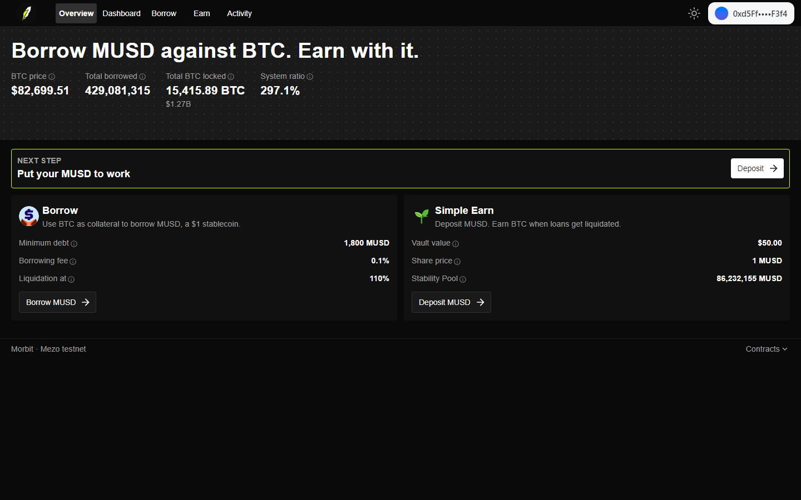
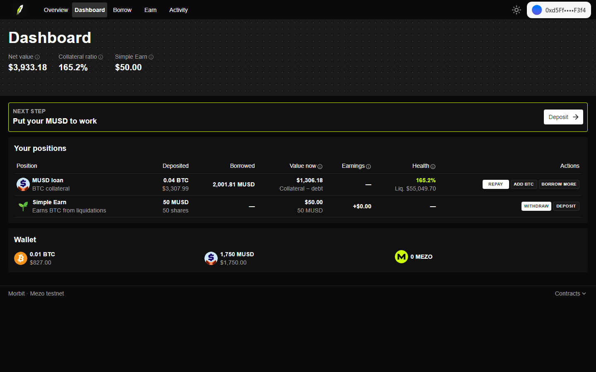
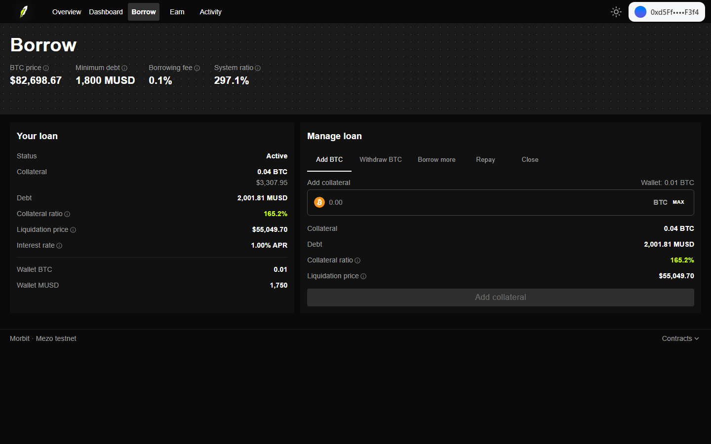
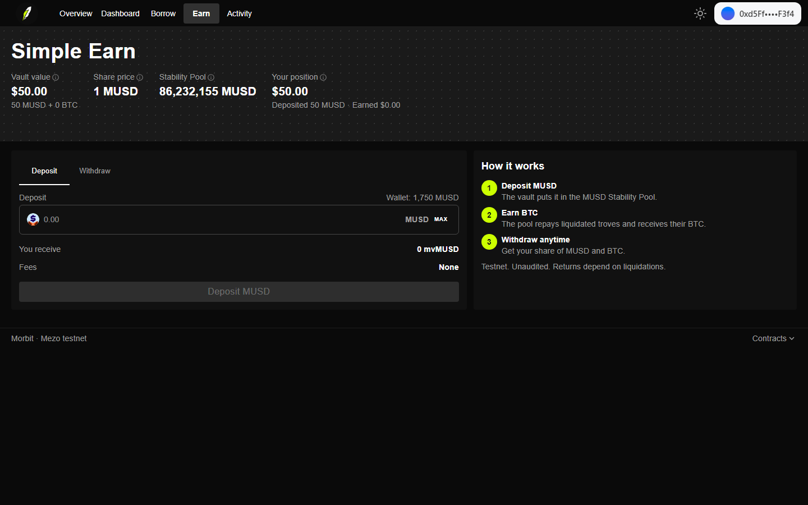
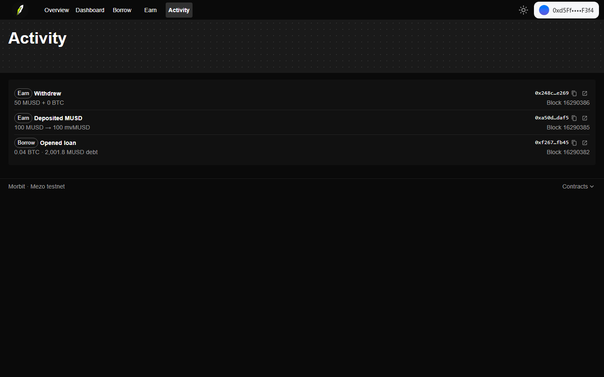

<p align="center">
  
</p>

<h1 align="center">Morbit</h1>

<p align="center"><b>Borrow MUSD against your BTC, then put that MUSD to work. Live on Mezo testnet.</b></p>

<p align="center">
  Built for the <a href="https://app.akindo.io/wave-hacks/OVOO0gdrVU8379D10">Mezo Buildathon</a>, DeFi track
</p>



## What it does

Bitcoin holders want liquidity without selling their BTC. Mezo's MUSD gives them a $1 stablecoin backed by BTC. Morbit lets them borrow that MUSD and put it to work, all in one app.

- **Borrow.** Lock BTC and mint MUSD. You can then add or withdraw BTC, borrow more, repay, or close the loan. Morbit calls Mezo's own MUSD contracts, so every loan is a real MUSD trove. Before you sign, the app shows your collateral ratio, your liquidation price and a **Safe max** amount that keeps you at a 200% ratio.
- **Simple Earn.** Deposit MUSD into the Morbit vault (`MorbitEarnVault`). The vault puts it into the MUSD Stability Pool, which repays liquidated loans and pays depositors in BTC. You can withdraw your share of the MUSD and BTC at any time.
- **Dashboard.** A positions table lists your loan and your Simple Earn deposit. It shows what you deposited, what you borrowed, what each is worth now, your earnings and your loan's health. One-click buttons let you Repay, Add BTC, Borrow more, Withdraw or Deposit.
- **Activity.** Your loan and vault history, read from the chain, with explorer links.

Every number in the app comes live from Mezo testnet. There is no mock data. Each stat has an "i" tooltip that explains it in one line.

| Dashboard | Borrow |
|---|---|
|  |  |
| **Simple Earn** | **Activity** |
|  |  |

## How it fits together

```
                 Morbit web app (Next.js · wagmi · viem)
                    │                              │
           Borrow   │                              │  Simple Earn
                    ▼                              ▼
     MUSD BorrowerOperations              MorbitEarnVault (mvMUSD shares)
     TroveManager · SortedTroves                   │ provideToSP / withdrawFromSP
     PriceFeed                                     ▼
                    │                       MUSD StabilityPool
                    └──── BTC collateral ◄────────┘  liquidation gains paid in BTC
```

### MUSD integration

| Morbit feature | MUSD contract | Calls |
|---|---|---|
| Open a loan (BTC in, MUSD out) | BorrowerOperations | `openTrove` (payable) |
| Add or withdraw BTC, borrow more, repay | BorrowerOperations | `adjustTrove` |
| Close a loan | BorrowerOperations | `closeTrove` |
| Cheap list inserts | SortedTroves | `findInsertPosition` |
| Loan state, system state | TroveManager | `getTroveStatus`, `getTroveColl`, `getTroveDebt`, `getEntireSystemColl`, `getEntireSystemDebt` |
| Minimum debt, borrowing fee | BorrowerOperations | `minNetDebt`, `borrowingRate` |
| BTC price | PriceFeed | `fetchPrice` |
| Simple Earn | StabilityPool | `provideToSP`, `withdrawFromSP`, `getCompoundedMUSDDeposit`, `getDepositorCollateralGain` |
| Loan history | BorrowerOperations | `TroveUpdated` events |

### MorbitEarnVault

[`contracts/contracts/MorbitEarnVault.sol`](contracts/contracts/MorbitEarnVault.sol)

- `deposit(assets, receiver)` takes MUSD, mints mvMUSD shares at the current share price, and supplies the MUSD to the Stability Pool in the same transaction.
- `redeem(shares, receiver, owner)` burns shares and pays out the pro-rata MUSD and BTC. The vault never swaps.
- `totalAssets()` counts idle MUSD, the compounded Stability Pool deposit, and held plus pending BTC valued at the MUSD PriceFeed price.
- A virtual share and asset of 1 protect against first-depositor inflation attacks. Only the Stability Pool can send BTC to the vault.
- The owner can set a deposit cap or pause deposits. Withdrawals can never be paused.

## Deployed on Mezo testnet (chain 31611)

| Contract | Address |
|---|---|
| **MorbitEarnVault** | [`0x8D6444887c22Eb1A32De4299E507C62EbAb4004A`](https://explorer.test.mezo.org/address/0x8D6444887c22Eb1A32De4299E507C62EbAb4004A) |
| MUSD | [`0x118917a40FAF1CD7a13dB0Ef56C86De7973Ac503`](https://explorer.test.mezo.org/address/0x118917a40FAF1CD7a13dB0Ef56C86De7973Ac503) |
| BorrowerOperations | [`0xCdF7028ceAB81fA0C6971208e83fa7872994beE5`](https://explorer.test.mezo.org/address/0xCdF7028ceAB81fA0C6971208e83fa7872994beE5) |
| TroveManager | [`0xE47c80e8c23f6B4A1aE41c34837a0599D5D16bb0`](https://explorer.test.mezo.org/address/0xE47c80e8c23f6B4A1aE41c34837a0599D5D16bb0) |
| StabilityPool | [`0x1CCA7E410eE41739792eA0A24e00349Dd247680e`](https://explorer.test.mezo.org/address/0x1CCA7E410eE41739792eA0A24e00349Dd247680e) |
| SortedTroves | [`0x722E4D24FD6Ff8b0AC679450F3D91294607268fA`](https://explorer.test.mezo.org/address/0x722E4D24FD6Ff8b0AC679450F3D91294607268fA) |
| PriceFeed | [`0x86bCF0841622a5dAC14A313a15f96A95421b9366`](https://explorer.test.mezo.org/address/0x86bCF0841622a5dAC14A313a15f96A95421b9366) |

These transactions prove the full flow works on chain:

| Step | Transaction |
|---|---|
| Open loan: 0.04 BTC in, 2,001.8 MUSD debt | [`0xf267dffa…fb45`](https://explorer.test.mezo.org/tx/0xf267dffaa6f649f818a4df8009d027b30db7eb20c761d5fbb3023c219122fb45) |
| Deposit 100 MUSD into Simple Earn | [`0xa50d20be…af5`](https://explorer.test.mezo.org/tx/0xa50d20bef8c5f6f92974e7da885b15b81fcaf799aa7077a06ffc4a1b86c9daf5) |
| Withdraw 50 mvMUSD | [`0x248c2083…e269`](https://explorer.test.mezo.org/tx/0x248c20830c31c465f5390cf429704381e3850f09c8db9a9da2dedcc1ae7ae269) |

## Run it locally

You need Node 20+ and a wallet such as MetaMask. Get testnet BTC from the [Mezo faucet](https://faucet.test.mezo.org).

### Web app

```bash
cd web
npx yarn@1.22.22 install
cp .env.example .env.local    # optional: WalletConnect project id, custom RPC
npx yarn@1.22.22 dev          # http://localhost:3000
```

The app asks your wallet to add and switch to Mezo testnet. It reads contract addresses from `web/ui-config/mezoDeployment.json`.

### Contracts

```bash
cd contracts
yarn install
yarn test          # vault tests against a mock Stability Pool and PriceFeed
```

To deploy your own vault and run a live end-to-end check, store a funded testnet key in the Hardhat keystore. The key never goes in a file.

```bash
npx hardhat keystore set DEPLOYER_PRIVATE_KEY
yarn deploy:mezo   # deploys MorbitEarnVault, writes web/ui-config/mezoDeployment.json
yarn smoke:mezo    # opens a loan, deposits MUSD into the vault, withdraws half
```

The smoke test locks 0.04 BTC by default (`SMOKE_COLL_BTC`), because the minimum loan is 1,800 MUSD plus a 200 MUSD reserve.

| Script | What it does |
|---|---|
| `yarn compile` | Compiles contracts |
| `yarn test` | Runs the vault tests |
| `yarn deploy:mezo` | Deploys the vault to Mezo testnet and writes the web config |
| `yarn smoke:mezo` | Runs the full borrow → deposit → withdraw flow on chain |

### Deploy the web app

`web/` is a standard Next.js app. On Vercel, import the repo and set the root directory to `web`.

## Tech stack

- **Contracts:** Solidity 0.8.28, Hardhat 3, OpenZeppelin, `node:test` with ethers v6
- **Web:** Next.js 16 (App Router), React, MUI, wagmi v2, viem, TanStack Query, ConnectKit
- **Chain:** Mezo testnet, with MUSD (a Liquity-style CDP) and the MUSD Stability Pool

## Repository

```
contracts/
  contracts/MorbitEarnVault.sol   Simple Earn vault
  contracts/mocks/                Test doubles: Stability Pool, PriceFeed, MUSD
  test/MorbitEarnVault.ts         Vault tests
  scripts/deploy-mezo.js          Deploys the vault, writes the web config
  scripts/smoke-mezo.js           Live end-to-end check on Mezo testnet
  config/mezo-testnet.js          MUSD system addresses
web/
  modules/mezo/                   App logic: config, ABIs, hooks, pages
  app/(main)/                     Routes: /, /dashboard, /borrow, /earn, /history
  ui-config/mezoDeployment.json   Addresses the app reads
```

## Limits

- Testnet only. The vault is not audited.
- Simple Earn earns only when loans get liquidated, so returns can be zero for long stretches. If BTC falls fast, the BTC you receive can be worth less than the MUSD it replaced.
- The Stability Pool blocks MUSD withdrawals while any loan sits below 110% and hasn't been liquidated yet. Morbit passes this through and explains it.
- Mezo's RPC limits log queries to 10,000 blocks, so Activity shows loan history from about the last 60,000 blocks. Loans you manage in Morbit are also saved in your browser.
