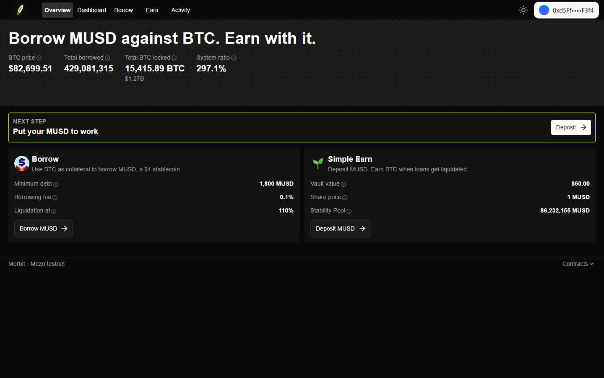
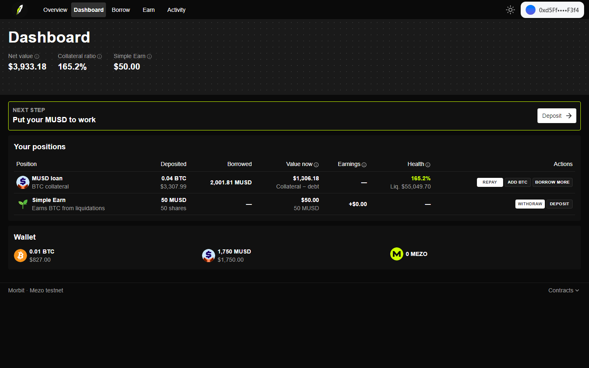
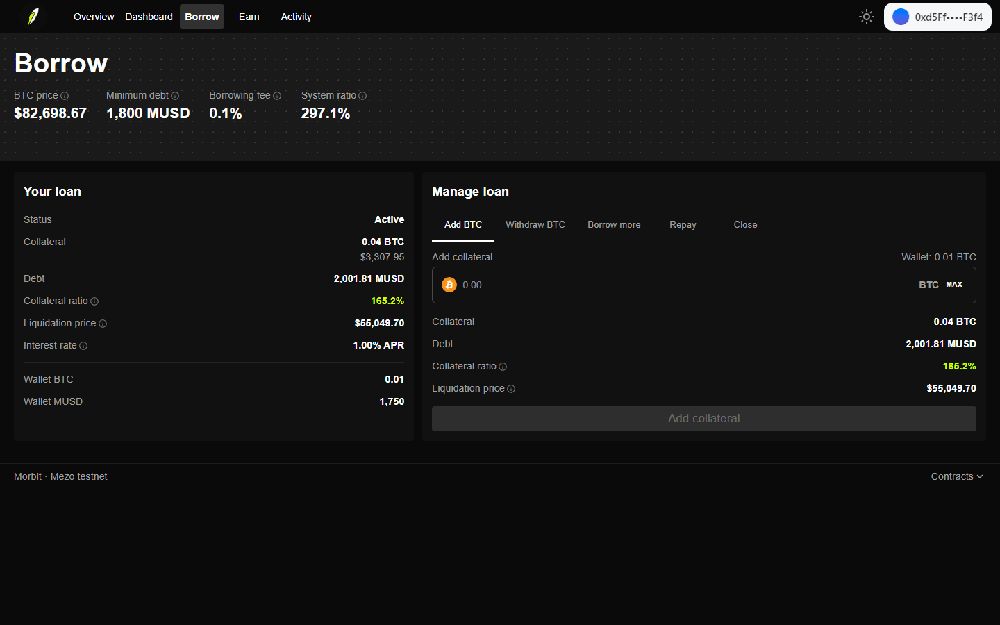
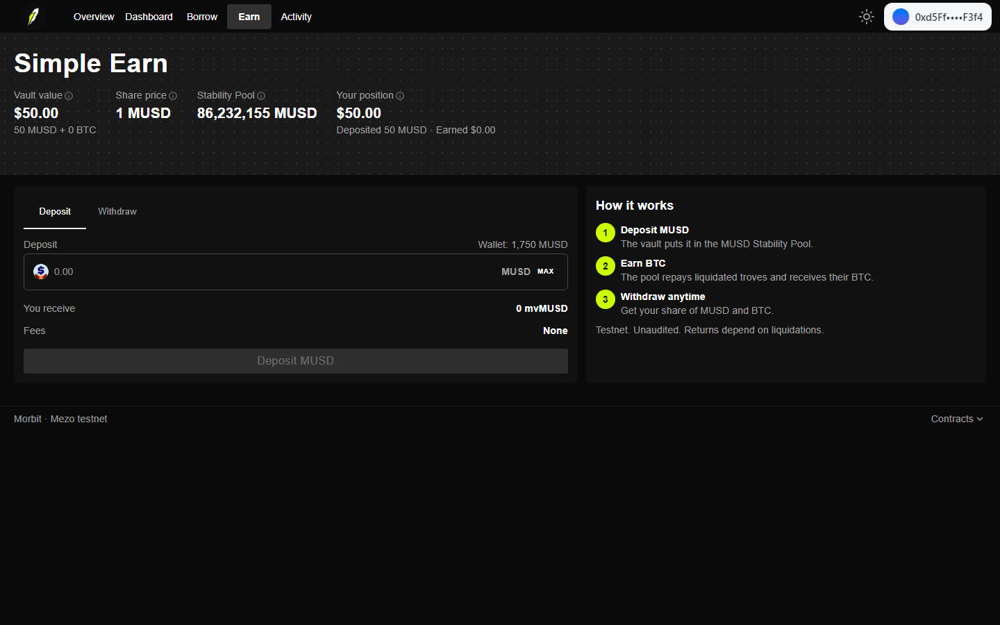
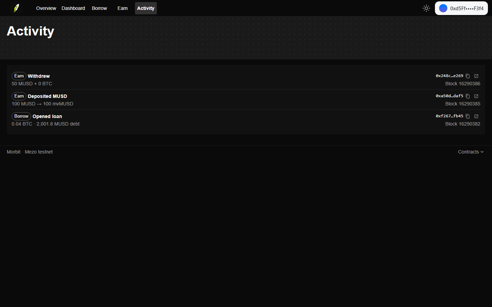

<p align="center">
  
</p>

<h1 align="center">Morbit</h1>

<p align="center"><b>Borrow MUSD against your BTC, then put that MUSD to work. Live on Mezo testnet.</b></p>

<p align="center">
  Built for the <a href="https://app.akindo.io/wave-hacks/OVOO0gdrVU8379D10">Mezo Buildathon</a>
</p>

| | |
|---|---|
| **Track** | Track 1: DeFi (MUSD and MEZO integration). The Telegram liquidation alerts bot also fits Track 2. |
| **Team** | Dickson ([Bruh-Codes](https://github.com/Bruh-Codes)): contracts, web app and bot. |
| **Try it** | [Tester guide](docs/TESTING.md) · [Live app](https://morbit-mezo.vercel.app) · [Alerts bot](https://t.me/Morbit_testnet_bot) |
| **Background** | Morbit started as a real-world-asset lending app (an Aave UI fork with our own `RWAPool` contract, [Bruh-Codes/Morbit](https://github.com/Bruh-Codes/Morbit)). For the buildathon we rebuilt it for Bitcoin on Mezo: every contract in this repo is new and MUSD-native, and the UI kept only the Aave-style layout. |



## Wave 2 judge feedback, addressed

| Feedback | What we did |
|---|---|
| Build the one-click borrow-into-vault loop in a contract | **Borrow & Earn**: `MorbitLoopAccount.openEarn` opens a MUSD trove and deposits everything borrowed into Auto Earn in one transaction, with the shares going to the user's wallet. `closeEarn` redeems the shares, repays, closes and returns the BTC plus any BTC the vault earned. First-time users sign once through the factory. |
| Give the vault share a downstream use | A **maMUSD/MUSD stable pool on Mezo Pools**, created and seeded by the deploy script. Auto Earn shares can be swapped for MUSD without withdrawing, or LP'd for swap fees. |
| Redeem should collect BTC even when the deposit is wiped | `redeem` and `harvest` now call `withdrawFromSP(0)` whenever `getDepositorCollateralGain > 0`, even with a zero compounded deposit. Tested with a liquidation that empties the vault's whole deposit. |
| Verify the vault on the explorer | The deploy script verifies every new contract on the Mezo explorer (Blockscout). `yarn verify:mezo` re-runs it. |
| Explain the Stability Pool withdrawal block | The app shows "A loan is waiting to be liquidated, which pauses Stability Pool withdrawals. Try again in a few minutes." instead of the revert, and our keeper liquidates those loans every 5 minutes. |
| Revenue model | A **10% performance fee** on compounded BTC gains (owner-set, hard cap 20%, never on deposits or withdrawals). It is shown in the app before you deposit. |
| Get real users through the full flow | A step-by-step [tester guide](docs/TESTING.md) covering borrow, Auto Earn, Borrow & Earn, a BTC-gain payout, the loop, the pool and the alerts bot. |

## Revenue model

Morbit earns only when depositors earn. Auto Earn keeps 10% of each compounding, taken from the MUSD that BTC liquidation gains are swapped into. Nothing is charged on deposits, withdrawals, loans or loops. The fee is set on chain (`performanceFeeBps`, capped at 20%), every change emits an event, and the app shows the current rate. On mainnet the same fee would fund audits and the keeper that liquidates loans and compounds the vault.

## What's new in Wave 2

Wave 1 shipped borrowing and Simple Earn. Wave 2 goes deeper into MUSD and adds MEZO and Mezo Pools:

| | What changed | Why it matters |
|---|---|---|
| **Auto Earn** | New vault ([`MorbitEarnVaultV2`](contracts/contracts/MorbitEarnVaultV2.sol)). The BTC that the Stability Pool pays for liquidations is swapped back to MUSD on **Mezo Pools** and redeposited, so earnings compound. Anyone can trigger it, and the swap must land within 3% of the MUSD oracle. | Depositors stay fully in MUSD instead of collecting BTC dust. |
| **MEZO rewards** | Auto Earn streams **MEZO** to depositors pro rata. The app shows the APR priced on Mezo Pools and has a one-click Claim. | First use of MEZO in Morbit. |
| **One-click BTC loop** | New [`MorbitLoopAccount`](contracts/contracts/MorbitLoop.sol). A personal account owns a MUSD trove, so *deposit BTC → borrow MUSD → buy BTC on Mezo Pools → add as collateral* is a single transaction, at 1.5x, 2x or 2.5x. Closing is one transaction too. | Leveraged BTC built only from MUSD and Mezo Pools. |
| **Liquidation alerts** | A [Telegram bot](alerts/) watches your loan and loop and warns you below 160%, escalating near liquidation or in recovery mode. It subscribes in one tap from the app and can also run the Auto Earn keeper. | Track 2: meets users where they are. |
| **Flow fixes** | Loan history no longer disappears after about two days, and history is cached so it loads fast. You can withdraw from Earn by amount or %. Loans under 160% are flagged with a "add BTC" next step. Borrow more has a Safe max. Protocol errors read in plain English. | Found by walking every flow against live testnet. |
| **Security** | 43 contract tests (up from 9), live `eth_call` simulations of every swap and loop path, and a written [security review](docs/SECURITY.md). | |

## What it does

Bitcoin holders want liquidity without selling their BTC. Mezo's MUSD gives them a $1 stablecoin backed by BTC. Morbit lets them borrow that MUSD and put it to work, all in one app.

- **Borrow.** Lock BTC and mint MUSD. You can then add or withdraw BTC, borrow more, repay, or close the loan. Morbit calls Mezo's own MUSD contracts, so every loan is a real MUSD trove. Before you sign, the app shows your collateral ratio, your liquidation price and a **Safe max** amount that keeps you at a 200% ratio.
- **Simple Earn.** Deposit MUSD into the Morbit vault (`MorbitEarnVault`). The vault puts it into the MUSD Stability Pool, which repays liquidated loans and pays depositors in BTC. You can withdraw your share of the MUSD and BTC at any time.
- **Dashboard.** A positions table lists your loan and your Simple Earn deposit. It shows what you deposited, what you borrowed, what each is worth now, your earnings and your loan's health. One-click buttons let you Repay, Add BTC, Borrow more, Withdraw or Deposit.
- **Activity.** Your loan and vault history, read from the chain, with explorer links.

Every number in the app comes live from Mezo testnet. There is no mock data. Each stat has an "i" tooltip that explains it in one line.

| Dashboard | Borrow |
|---|---|
|  |  |
| **Simple Earn** | **Activity** |
|  |  |

## How it fits together

```
                 Morbit web app (Next.js · wagmi · viem)
                    │                              │
           Borrow   │                              │  Simple Earn
                    ▼                              ▼
     MUSD BorrowerOperations              MorbitEarnVault (mvMUSD shares)
     TroveManager · SortedTroves                   │ provideToSP / withdrawFromSP
     PriceFeed                                     ▼
                    │                       MUSD StabilityPool
                    └──── BTC collateral ◄────────┘  liquidation gains paid in BTC
```

### MUSD integration

| Morbit feature | MUSD contract | Calls |
|---|---|---|
| Open a loan (BTC in, MUSD out) | BorrowerOperations | `openTrove` (payable) |
| Add or withdraw BTC, borrow more, repay | BorrowerOperations | `adjustTrove` |
| Close a loan | BorrowerOperations | `closeTrove` |
| Cheap list inserts | SortedTroves | `findInsertPosition` |
| Loan state, system state | TroveManager | `getTroveStatus`, `getTroveColl`, `getTroveDebt`, `getEntireSystemColl`, `getEntireSystemDebt` |
| Minimum debt, borrowing fee | BorrowerOperations | `minNetDebt`, `borrowingRate` |
| BTC price | PriceFeed | `fetchPrice` |
| Simple Earn | StabilityPool | `provideToSP`, `withdrawFromSP`, `getCompoundedMUSDDeposit`, `getDepositorCollateralGain` |
| Loan history | BorrowerOperations | `TroveUpdated` events |
| Auto-compounding, loops | Mezo Pools Router (BTC/MUSD pool) | `swapExactTokensForTokens`, `getAmountsOut` |
| MEZO rewards and APR | MEZO token, Mezo Pools (MEZO/MUSD) | `transfer`, `getAmountsOut` |
| Loop and Borrow & Earn trove | BorrowerOperations (called by the user's Morbit account) | `openTrove`, `adjustTrove`, `closeTrove` |
| maMUSD/MUSD pool | Mezo Pools PoolFactory, Router | `createPool`, `addLiquidity` |

### MorbitEarnVault

[`contracts/contracts/MorbitEarnVault.sol`](contracts/contracts/MorbitEarnVault.sol)

- `deposit(assets, receiver)` takes MUSD, mints mvMUSD shares at the current share price, and supplies the MUSD to the Stability Pool in the same transaction.
- `redeem(shares, receiver, owner)` burns shares and pays out the pro-rata MUSD and BTC. The vault never swaps.
- `totalAssets()` counts idle MUSD, the compounded Stability Pool deposit, and held plus pending BTC valued at the MUSD PriceFeed price.
- A virtual share and asset of 1 protect against first-depositor inflation attacks. Only the Stability Pool can send BTC to the vault.
- The owner can set a deposit cap or pause deposits. Withdrawals can never be paused.

## Deployed on Mezo testnet (chain 31611)

| Contract | Address |
|---|---|
| **Auto Earn** (MorbitEarnVaultV2, verified) | [`0xA8BAc7913D5163E2dF9aE3aF5B0AEeA44529Ac70`](https://explorer.test.mezo.org/address/0xA8BAc7913D5163E2dF9aE3aF5B0AEeA44529Ac70?tab=contract) |
| **MorbitLoopFactory** (loop + Borrow & Earn, verified) | [`0x6e43AEce3302f16adAa6A19c7eFb8521f8c55A4b`](https://explorer.test.mezo.org/address/0x6e43AEce3302f16adAa6A19c7eFb8521f8c55A4b?tab=contract) |
| **maMUSD/MUSD stable pool** (Mezo Pools) | [`0xBF329A2A130cb0D5B5218f1672E51Fb36089FDE0`](https://explorer.test.mezo.org/address/0xBF329A2A130cb0D5B5218f1672E51Fb36089FDE0) |
| **MezoPoolsSwapper** (verified) | [`0x219cCC99aB55c001f9c48cEC3740d6a64518bD72`](https://explorer.test.mezo.org/address/0x219cCC99aB55c001f9c48cEC3740d6a64518bD72?tab=contract) |
| Previous Auto Earn (withdrawals only) | [`0x23d80c8c231D7BF671AC54cd5854728535063254`](https://explorer.test.mezo.org/address/0x23d80c8c231D7BF671AC54cd5854728535063254) |
| Previous Loop factory (unused) | [`0x1793939e946eaC24Db782c59AC848ec8112f333d`](https://explorer.test.mezo.org/address/0x1793939e946eaC24Db782c59AC848ec8112f333d) |
| **Simple Earn** (MorbitEarnVault) | [`0x8D6444887c22Eb1A32De4299E507C62EbAb4004A`](https://explorer.test.mezo.org/address/0x8D6444887c22Eb1A32De4299E507C62EbAb4004A) |
| MUSD | [`0x118917a40FAF1CD7a13dB0Ef56C86De7973Ac503`](https://explorer.test.mezo.org/address/0x118917a40FAF1CD7a13dB0Ef56C86De7973Ac503) |
| BorrowerOperations | [`0xCdF7028ceAB81fA0C6971208e83fa7872994beE5`](https://explorer.test.mezo.org/address/0xCdF7028ceAB81fA0C6971208e83fa7872994beE5) |
| TroveManager | [`0xE47c80e8c23f6B4A1aE41c34837a0599D5D16bb0`](https://explorer.test.mezo.org/address/0xE47c80e8c23f6B4A1aE41c34837a0599D5D16bb0) |
| StabilityPool | [`0x1CCA7E410eE41739792eA0A24e00349Dd247680e`](https://explorer.test.mezo.org/address/0x1CCA7E410eE41739792eA0A24e00349Dd247680e) |
| SortedTroves | [`0x722E4D24FD6Ff8b0AC679450F3D91294607268fA`](https://explorer.test.mezo.org/address/0x722E4D24FD6Ff8b0AC679450F3D91294607268fA) |
| PriceFeed | [`0x86bCF0841622a5dAC14A313a15f96A95421b9366`](https://explorer.test.mezo.org/address/0x86bCF0841622a5dAC14A313a15f96A95421b9366) |

These transactions prove the full flow works on chain:

| Step | Transaction |
|---|---|
| Open loan: 0.04 BTC in, 2,001.8 MUSD debt | [`0xf267dffa…fb45`](https://explorer.test.mezo.org/tx/0xf267dffaa6f649f818a4df8009d027b30db7eb20c761d5fbb3023c219122fb45) |
| Deposit 100 MUSD into Simple Earn | [`0xa50d20be…af5`](https://explorer.test.mezo.org/tx/0xa50d20bef8c5f6f92974e7da885b15b81fcaf799aa7077a06ffc4a1b86c9daf5) |
| Withdraw 50 mvMUSD | [`0x248c2083…e269`](https://explorer.test.mezo.org/tx/0x248c20830c31c465f5390cf429704381e3850f09c8db9a9da2dedcc1ae7ae269) |
| Wave 2: deploy Auto Earn | [`0x819bb787…c466`](https://explorer.test.mezo.org/tx/0x819bb78708aeebb4456b2c293d553b7fb36525b8c79052f8fc97ffd80e39c466) |
| Wave 2: deploy the loop factory | [`0x3105068e…5366`](https://explorer.test.mezo.org/tx/0x3105068ed9615ea2467b9be75b6dd2f12e18ef87b11af14ab505572779f15366) |
| Wave 2: seed 1 MUSD of dead shares | [`0x9078424f…aaed`](https://explorer.test.mezo.org/tx/0x9078424f1a5faa7ce5b9d7164c730bcad0deace3d1cef14e5a13075c8155aaed) |
| Wave 2: stream 100 MEZO to Auto Earn over 14 days | [`0x24faf361…2813`](https://explorer.test.mezo.org/tx/0x24faf361233475aaa361e2bc3e17172656d02a6d402198c532bfa21140e82813) |
| Wave 2: deposit 100 MUSD into Auto Earn | [`0x6907fc0c…580d`](https://explorer.test.mezo.org/tx/0x6907fc0c76dc5a1fe2ed528e0506cf15be0d00e21461ce634a2c16d615ad580d) |
| Judge feedback: deploy the new Auto Earn vault | [`0x6ac197b0…63f6`](https://explorer.test.mezo.org/tx/0x6ac197b0ac6c9eae9d50d051aa604caea7f4695c0eca19d5fa15ad1b184963f6) |
| Judge feedback: seed 1 MUSD of dead shares | [`0x4c10aa1b…4e89`](https://explorer.test.mezo.org/tx/0x4c10aa1bab7decaec886335a0cebe354e7f345d827e7153e1781b64e43fe4e89) |
| Judge feedback: deploy the Loop factory with Borrow & Earn | [`0xe41d4e89…c489`](https://explorer.test.mezo.org/tx/0xe41d4e8909146ca6099158eeae2d2ee846c590e95630263e6b932cf78ff9c489) |
| Judge feedback: create the maMUSD/MUSD pool on Mezo Pools | [`0xe36de931…545f`](https://explorer.test.mezo.org/tx/0xe36de93142417a6f058209f8d40fab631858d4b2dc90f717767e4442fda1545f) |
| Judge feedback: add 10 maMUSD + 10 MUSD of liquidity | [`0xac213052…63bd`](https://explorer.test.mezo.org/tx/0xac213052e8cef97a6e336a0586fb6fab858b4a7eb8298209040746e1882063bd) |
| Wave 2: liquidate 5 loans under 110%, which unblocked Stability Pool withdrawals and paid Auto Earn its first BTC | [`0x52f169f8…9dcd`](https://explorer.test.mezo.org/tx/0x52f169f8ffe057973490c37eb76d0b10d913f433b8e72ea23f8edc8b51479dcd) |

## Run it locally

You need Node 20+ and a wallet such as MetaMask. Get testnet BTC from the [Mezo faucet](https://faucet.test.mezo.org).

### Web app

```bash
cd web
npx yarn@1.22.22 install
cp .env.example .env.local    # optional: WalletConnect project id, custom RPC
npx yarn@1.22.22 dev          # http://localhost:3000
```

The app asks your wallet to add and switch to Mezo testnet. It reads contract addresses from `web/ui-config/mezoDeployment.json`.

### Contracts

```bash
cd contracts
yarn install
yarn test          # 43 tests: vaults, loop, Borrow & Earn, against mocks of the MUSD system
```

To deploy your own vault and run a live end-to-end check, store a funded testnet key in the Hardhat keystore. The key never goes in a file.

```bash
npx hardhat keystore set DEPLOYER_PRIVATE_KEY
yarn deploy:mezo   # deploys MorbitEarnVault, writes web/ui-config/mezoDeployment.json
yarn smoke:mezo    # opens a loan, deposits MUSD into the vault, withdraws half
```

The smoke test locks 0.04 BTC by default (`SMOKE_COLL_BTC`), because the minimum loan is 1,800 MUSD plus a 200 MUSD reserve.

| Script | What it does |
|---|---|
| `yarn compile` | Compiles contracts |
| `yarn test` | Runs the vault tests |
| `yarn deploy:mezo` | Deploys the vault to Mezo testnet and writes the web config |
| `yarn smoke:mezo` | Runs the full borrow → deposit → withdraw flow on chain |
| `yarn deploy:wave2` | Deploys the swapper, Auto Earn and the loop factory, and seeds dead shares. Optional `REWARD_MEZO`, `REWARD_DAYS` |
| `yarn smoke:auto-earn` | Deposit, harvest, claim and redeem against live Auto Earn |
| `yarn finish:wave2` | Seeds Auto Earn and starts a MEZO stream (`REWARD_MEZO`) if `deploy:wave2` stopped early |
| `yarn liquidate` | Liquidates loans under 110% (this unblocks Stability Pool withdrawals) and compounds Auto Earn |
| `yarn deploy:earn-v3` | Judge-feedback release: new Auto Earn vault (fee, wiped-deposit fix), Loop factory with Borrow & Earn, maMUSD/MUSD pool (`POOL_MUSD`, default 10), optional `REWARD_MEZO`, explorer verification. The previous vault stays listed for withdrawals |
| `yarn verify:mezo` | Verifies the current vault, Loop factory and swapper on the Mezo explorer |

### Deploy the web app

`web/` is a standard Next.js app. On Vercel, import the repo and set the root directory to `web`.

## Tech stack

- **Contracts:** Solidity 0.8.28, Hardhat 3, OpenZeppelin, `node:test` with ethers v6
- **Web:** Next.js 16 (App Router), React, MUI, wagmi v2, viem, TanStack Query, ConnectKit
- **Chain:** Mezo testnet, with MUSD (a Liquity-style CDP) and the MUSD Stability Pool

## Repository

```
contracts/
  contracts/MorbitEarnVault.sol   Simple Earn vault
  contracts/MorbitEarnVaultV2.sol Auto Earn: compounding via Mezo Pools + MEZO rewards
  contracts/MezoPoolsSwapper.sol  BTC <-> MUSD on Mezo Pools
  contracts/MorbitLoop.sol        Morbit account + factory: one-click BTC loop and Borrow & Earn
  contracts/mocks/                Test doubles: Stability Pool, PriceFeed, MUSD
  test/                           Vault, Auto Earn and loop tests
  scripts/deploy-mezo.js          Deploys the vault, writes the web config
  scripts/smoke-mezo.js           Live end-to-end check on Mezo testnet
  config/mezo-testnet.js          MUSD system addresses
web/
  modules/mezo/                   App logic: config, ABIs, hooks, pages
  app/(main)/                     Routes: /, /dashboard, /borrow, /earn, /loop, /history
  ui-config/mezoDeployment.json   Addresses the app reads
alerts/                           Telegram liquidation alerts bot + Auto Earn keeper
docs/SECURITY.md                  Security review
docs/TESTING.md                   Tester guide
```

## Limits

- Testnet only. The contracts are not audited. See the [security review](docs/SECURITY.md).
- Simple Earn earns only when loans get liquidated, so returns can be zero for long stretches. If BTC falls fast, the BTC you receive can be worth less than the MUSD it replaced.
- The Stability Pool blocks MUSD withdrawals while any loan sits below 110% and hasn't been liquidated yet. Morbit passes this through and explains it.
- Mezo's RPC limits log queries to 10,000 blocks, so Activity reads history in chunks from shortly before launch and caches what it has scanned in the browser.
- Loops are ordinary MUSD troves, so they can be liquidated like any loan. Testnet Mezo Pools prices can drift a few percent from the oracle, and swaps beyond 5% revert.
